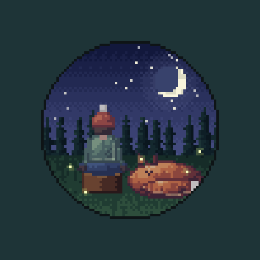
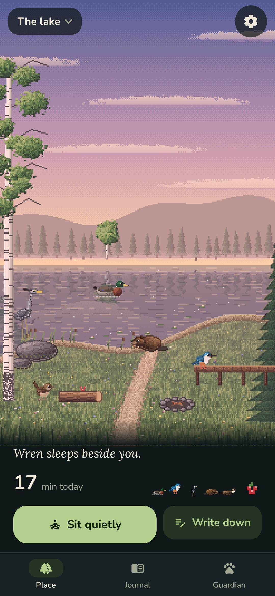
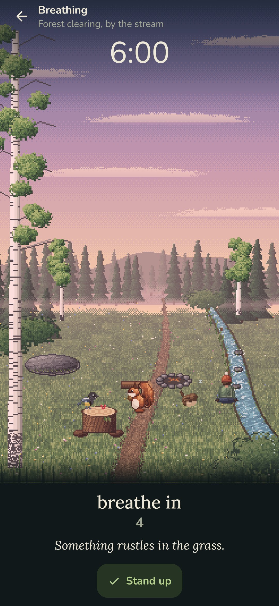
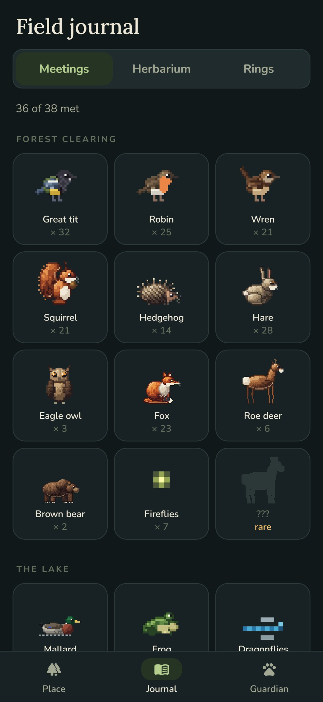
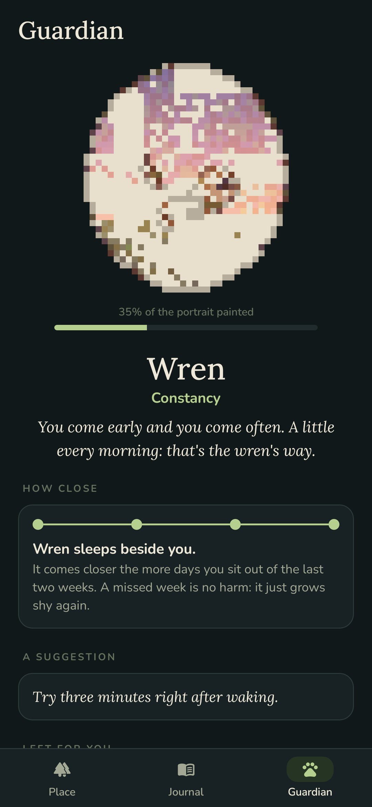

<div align="center">



# Hushwood

### Sit quietly, and the forest will come to you.

*A cosy pixel-art meditation and practice tracker. Put the phone down and sit still: the longer and quieter you sit, the bolder the animals get. A movement sends them back into the trees. A guardian animal chooses you by how you practise, and places open as the minutes add up: a forest clearing, a lake, a mountain meadow, the sea. Free, no ads, no account, no internet.*

[](https://github.com/bigdevwhale/hushwood/actions/workflows/android.yml)
[](https://github.com/bigdevwhale/hushwood/releases/latest)


[](LICENSE)

**English** · [Русский](README.ru.md) · [Changelog](CHANGELOG.md)

   

</div>

---

## The idea

Shy animals come out when you're still. Hushwood turns that into a practice: you sit (or breathe, or stretch, or write a page), the phone lies still beside you, and the place slowly fills with life. Nothing is lost when you skip a day; the animals just grow a little shy again.

## How it works

- **Sit quietly.** Pick a practice and a length (or none). You sit at your spot in the picture: meditation on the stump, breathing by the water, yoga on the stone, a journal by the fire, a walk on the path. The place's own sounds play: wind, water, birds, crickets, a fire.
- **Stillness brings them.** The accelerometer watches for jolts. Quiet builds minute by minute; tits and robins come first, a fox after eight minutes, a deer after twelve, a bear after twenty. Pick the phone up and they run, but come back sooner. Practices in motion gather quiet more slowly and aren't startled.
- **Breathing.** Four rhythms (calm 4–6, even, box, 4–7–8). Motes of light gather round you on the in-breath and spread on the out-breath; a tick under the finger as the phase turns.
- **Four places, 38 animals.** A forest clearing; a lake with a pier, ducks, swans, beavers, an otter and a moose; a mountain meadow with marmots, pikas, an ibex, a lynx and a golden eagle; the shore with crabs, puffins on the cliff, seals and a whale far out. Each has its own hours and seasons. The lake, the mountains and the sea open as your minutes add up.
- **Rare guests.** A white deer at dawn after half an hour of quiet; a kingfisher for someone who breathes by the water seven days of ten; cranes passing over at the equinox; a snow leopard on winter nights.
- **The guardian.** After two weeks, one animal steps out and stays: wren, owl, heron, crane, bear, fox, hedgehog or deer, read from when, how long and how you practise. It comes closer the more days you sit (watching from the bushes, at the edge, halfway, asleep beside you) and sometimes leaves a gift by the stump.
- **A portrait, pixel by pixel.** Each sitting paints part of the guardian's portrait, tinted by its hour: rosy dawn, golden day, amber dusk, blue night. A finished portrait goes up on the shelf, and the forest looks again at how you practise.
- **Offerings.** After a sitting, leave seeds, berries, nuts, an apple or honey on the stump; whoever likes it comes sooner next time.
- **Field journal.** Everyone you've met (and silhouettes of those you haven't), a herbarium of one-line notes pressed as leaves, and the year as the rings of a cut stump.
- **The real hour and season.** Dawn, day, dusk and night; spring flowers, summer fireflies, autumn leaves, winter snow.
- **Widget and reminder.** The place on the home screen as it is now, and an optional daily reminder on days you haven't sat.

## Privacy

Everything stays on the phone. No accounts, no analytics, no internet permission. The accelerometer is read only while a sitting is on.

## Build

```
git clone https://github.com/bigdevwhale/hushwood.git
cd hushwood
./gradlew testDebugUnitTest     # unit tests
./gradlew assembleDebug         # app.hushwood.dev, installs next to a release
./gradlew assembleDebug -Pdemo  # app.hushwood.demo with half a year of made-up sittings
./gradlew testDebugUnitTest -Prender --tests '*RenderArt*' && python tools/shots.py  # art sheets and screenshots
```

All the art (places, animals, portraits, the icon) is painted in code on the phone; see `app/src/main/java/app/hushwood/ui/pix`.

## License

MIT
