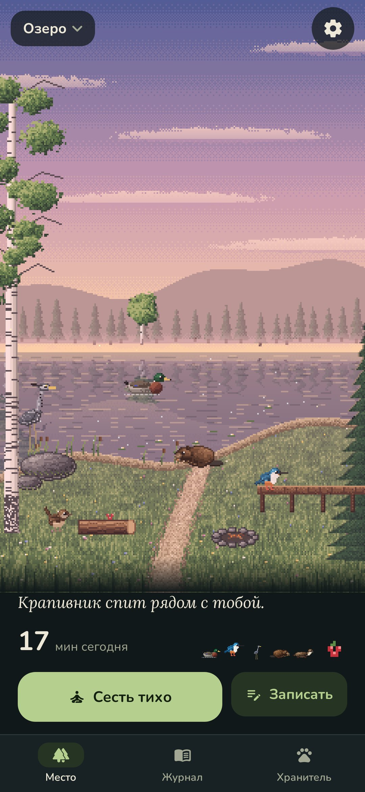
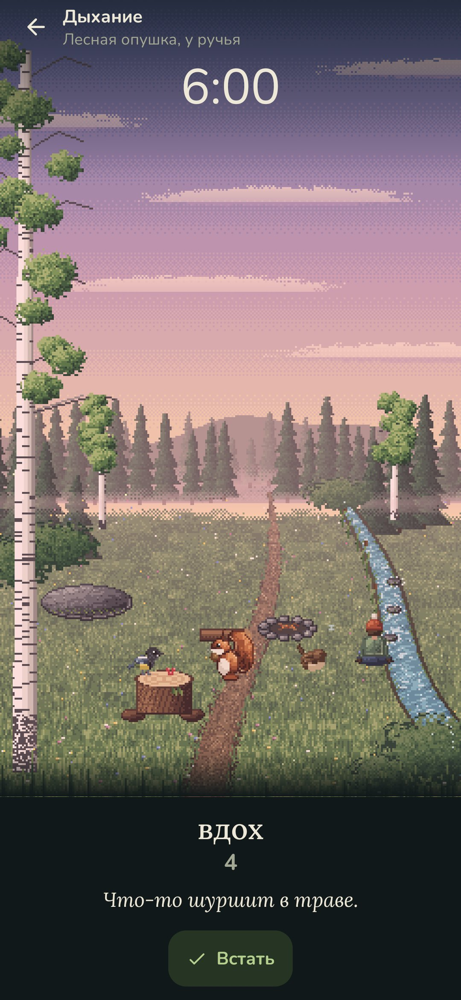
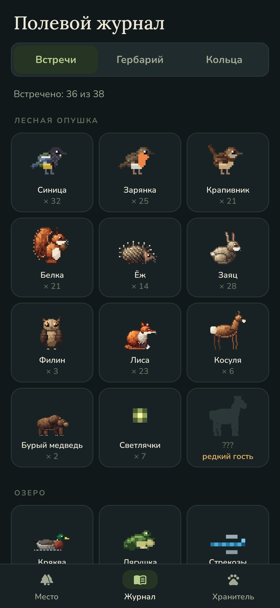
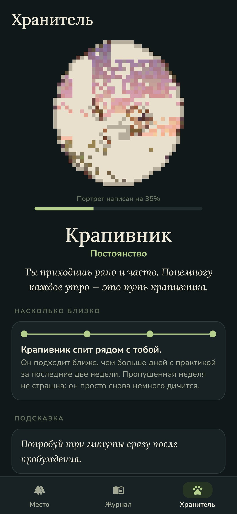

<div align="center">


# Hushwood

### Сиди тихо — и лес выйдет к тебе.

*Уютный пиксельный трекер медитации и практик. Положи телефон и замри: чем дольше и тише ты сидишь, тем смелее звери. Одно движение — и они убегают в лес. Зверь-хранитель выбирает тебя по тому, как ты практикуешь, а с минутами открываются новые места: лесная опушка, озеро, горный луг, море. Бесплатно, без рекламы, без аккаунта, без интернета.*

[](https://github.com/bigdevwhale/hushwood/actions/workflows/android.yml)
[](https://github.com/bigdevwhale/hushwood/releases/latest)


[](LICENSE)

[English](README.md) · **Русский** · [Изменения](CHANGELOG.md)

   

</div>

---

## Идея

Пугливые звери выходят, когда ты неподвижен. Hushwood превращает это в практику: ты сидишь (дышишь, тянешься, пишешь страницу), телефон лежит рядом, и место понемногу наполняется жизнью. Пропущенный день ничего не отнимает — звери просто снова немного дичатся.

## Как это работает

- **Сесть тихо.** Выбери практику и длительность (или без неё). Ты появляешься на своём месте в картинке: медитация на пне, дыхание у воды, йога на камне, дневник у костра, прогулка на тропе. Звучит само место: ветер, вода, птицы, сверчки, костёр.
- **Тишина их приводит.** Акселерометр замечает толчки. Тишина копится минута за минутой: сначала синицы и зарянки, лиса через восемь минут, косуля через двенадцать, медведь через двадцать. Взял телефон — разбежались, но вернутся быстрее. Практики в движении копят тишину медленнее и не пугают зверей.
- **Дыхание.** Четыре ритма (спокойное 4–6, ровное, квадрат, 4–7–8). Огоньки собираются вокруг тебя на вдохе и расходятся на выдохе, на смене фазы — лёгкая вибрация.
- **Четыре места, 38 зверей.** Лесная опушка; озеро с мостками, утками, лебедем, бобром, выдрой и лосем; горный луг с сурками, пищухой, козерогом, рысью и беркутом; морской берег с крабами, тупиками на утёсе, тюленями и китом вдали. У каждого свои часы и сезоны. Озеро, горы и море открываются с минутами практики.
- **Редкие гости.** Белый олень на рассвете после получаса тишины, зимородок для того, кто дышит у воды семь дней из десяти, журавлиный клин в равноденствие, снежный барс зимней ночью.
- **Хранитель.** Через две недели один зверь выходит и остаётся: крапивник, филин, цапля, журавль, медведь, лиса, ёж или косуля — по тому, когда, сколько и как ты практикуешь. Чем больше дней с практикой, тем ближе он подходит (смотрит из кустов, ждёт на краю, на полпути, спит рядом) и иногда оставляет подарок у пня.
- **Портрет по пикселю.** Каждая практика дописывает кусочек портрета хранителя цветом своего часа: розовым на рассвете, золотым днём, янтарным в сумерках, синим ночью. Готовый портрет встаёт на полку, а лес снова смотрит, как ты практикуешь.
- **Подношения.** После практики оставь на пне семечки, ягоды, орехи, яблоко или мёд — кто это любит, придёт в следующий раз быстрее.
- **Полевой журнал.** Все встреченные звери (и силуэты ещё не встреченных), гербарий строчек-листьев и год как кольца спила.
- **Настоящие час и сезон.** Рассвет, день, сумерки, ночь; весенние цветы, летние светлячки, осенние листья, зимний снег.
- **Виджет и напоминание.** Место на домашнем экране, каким оно сейчас, и необязательное напоминание в дни без практики.

## Приватность

Всё остаётся на телефоне. Ни аккаунтов, ни аналитики, ни доступа к интернету. Акселерометр читается только во время практики.

## Сборка

```
git clone https://github.com/bigdevwhale/hushwood.git
cd hushwood
./gradlew testDebugUnitTest     # тесты
./gradlew assembleDebug         # app.hushwood.dev, ставится рядом с релизом
./gradlew assembleDebug -Pdemo  # app.hushwood.demo с полугодом выдуманных практик
./gradlew testDebugUnitTest -Prender --tests '*RenderArt*' && python tools/shots.py  # арт и скриншоты
```

Весь арт (места, звери, портреты, иконка) рисуется кодом прямо на телефоне — см. `app/src/main/java/app/hushwood/ui/pix`.

## Лицензия

MIT
